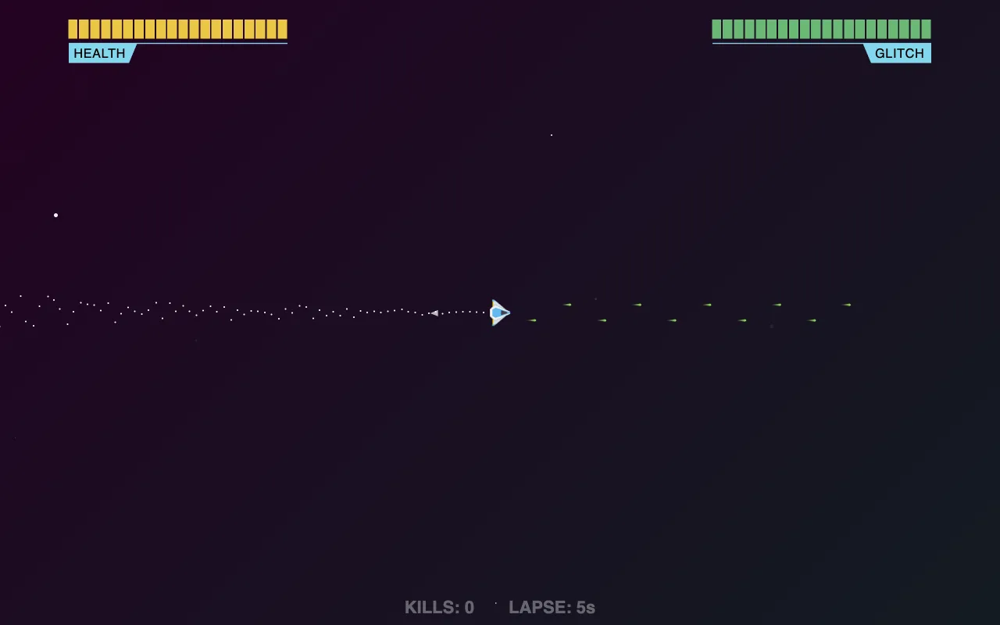

# Spacetime — js13kGames 2016

A space shooter made for [js13kGames 2016](https://js13kgames.com/games/spacetime), where the whole game has to fit in 13 KB. Play against the CPU, or against a friend in split screen.

**[Play it in your browser](https://spacetime.projectz.co.nz)**

## Controls

- **Keyboard:** arrows to fly, Ctrl to shoot, Shift to glitch.
- **Xbox controller:** RT, A and B.
- Press shoot on the start screen to join. Split screen waits for a second player.

## How it's built

Plain JavaScript and SVG, no libraries. `spacetime/build.php` joins the scripts in `spacetime/src/`, shortens the names and minifies everything into one HTML file, `spacetime/build/index.min.html`. `spacetime/build/spacetime.zip` is the 11 KB entry as submitted.
